  

<h3 align="center">Ph.D., PDF (AI) · Hyderabad, India · 60+ SCI/Scopus/IEEE Publications · 11+ Patents · 11 Books</h3>

  
  
  
  
  
  

  

  

  

---

## About Me

<table>
<tr>
<td width="62%" valign="top">

I am an **Agentic AI scientist and educator** who turns frontier AI research into systems people can trust.

As **Founder, CEO & Chief Agentic AI Scientist of [AlgoProfessor AI R&D Solutions](https://www.algoprofessor.com)** in Hyderabad, I lead research and product work on governed multi-agent AI. I designed **[AlgoLang](https://github.com/drssnaiml1-cell/algolang)**, an agent-native programming language in which every AI decision is checked, explained, signed and tested before it ships. I also created the **ASTRA** AI reference architecture.

My research spans **agentic AI, trustworthy and explainable AI, graph machine learning, deep learning, quantum AI and AI security**. I mentor **56 Ph.D. and postdoctoral scholars**, including international postdoctoral co-supervision at **NYUST** and **NKUST** in Taiwan.

</td>
<td width="38%" valign="top">

**At a glance**

🎓 Ph.D., PDF (AI) 
📚 60+ SCI / Scopus / IEEE papers 
💡 11+ published patents 
📖 11 books 
🧑‍🎓 56 Ph.D. & postdoctoral scholars 
⏳ 22 years in teaching & R&D 
🧠 Creator of AlgoLang & ASTRA 
📍 Hyderabad, India

</td>
</tr>
</table>

---

## What I Build

| Domain | What I Do |
|:--|:--|
| **Agentic AI** | Multi-agent systems with policies, human oversight and signed audit trails |
| **Programming languages** | [AlgoLang](https://github.com/drssnaiml1-cell/algolang): an agent-native language, compiler and runtime |
| **Trustworthy AI** | Fairness and robustness testing, explainability, AI system cards, evidence packs |
| **LLM & SLM systems** | RAG, model cascades, graph optimisation of large and small models |
| **Graph ML & Deep Learning** | Graph neural networks, medical imaging, time-series forecasting |
| **Quantum AI** | QAOA optimisation, quantum circuits, quantum-safe security |
| **Quant finance** | Algorithmic trading research, backtesting and risk controls |

---

## Featured Project: AlgoLang

  

  
  
  

**Write AI systems as agents, not functions.** AlgoLang compiles governed multi-agent programs in which every decision is checked, explained, signed and tested before it ships.

<table>
<tr>
<td width="50%" valign="top">

**Language & runtime**
- Agents and flows instead of functions
- `uncertain<T>` values with confidence
- Compile-time safety rules (E100–E130)
- AlgoPulse™ real-time event streams
- Quantum circuits and verified QAOA

</td>
<td width="50%" valign="top">

**Trust & scale**
- Risk levels, PII redaction, explanations
- Fairness and robustness tests in `eval`
- Ed25519-signed audit and system cards
- 21 enterprise applications, 120 domain packs
- LLM & SLM graph optimisation

</td>
</tr>
</table>

<b>21 applications built in AlgoLang</b> (click to expand)

 

| Domain | Application |
|:--|:--|
| Insurance · Healthcare · Banking · Education | Claims Operations · Hospital Care · Bank Credit & KYC · Admissions & OBE |
| Cybersecurity · Logistics · Government · Legal | SOC Incident Command · Supply Chain Tower · Citizen Services · Contract Desk |
| Capital markets · Quantum · AI platform | Algo Trading Desk · Quantum Optimization Lab · AlgoGraph™ LLM & SLM Optimizer |
| Machine learning · Reinforcement learning · XAI | Model Factory · RL Control Room · XAI Audit Studio |
| NLP · Indian languages · Digital health | Document Intelligence · Bharat Bhasha Desk · Remote Monitoring |
| Biology · Engineering · Smart cities · Transport | Network Biology Lab · Predictive Maintenance · City Operations · Transport Optimizer |

---

## Research & Publications

| | |
|:--|:--|
| **Publications** | 60+ SCI / Scopus / IEEE journal and conference papers |
| **Patents** | 11+ published patents |
| **Books** | 11 books |
| **Research areas** | Agentic AI · Graph ML · Explainable AI · Medical imaging · Cloud & IoT security · Energy-aware AI |
| **Profiles** | [Google Scholar](https://scholar.google.com/citations?user=4Oo8gqoAAAAJ) · [ORCID](https://orcid.org/0000-0001-8285-113X) · [Scopus](https://www.scopus.com/authid/detail.uri?authorId=60329650200) |

---

## Tech Stack

   
   
  

  
  
  
  
  
  

---

## GitHub Activity

  
  

  

  <picture>
    <source media="(prefers-color-scheme: dark)" srcset="https://raw.githubusercontent.com/drssnaiml1-cell/drssnaiml1-cell/output/snake-dark.svg">
    <source media="(prefers-color-scheme: light)" srcset="https://raw.githubusercontent.com/drssnaiml1-cell/drssnaiml1-cell/output/snake-light.svg">
    
  </picture>

---

  <i>"Research that does not ship is only half done. Build AI people can trust, then prove it."</i>

  <b>AlgoProfessor AI R&amp;D Solutions</b> · Hyderabad, India · <a href="https://www.algoprofessor.com">www.algoprofessor.com</a> · <a href="mailto:ceo@algoprofessor.com">ceo@algoprofessor.com</a>

  

